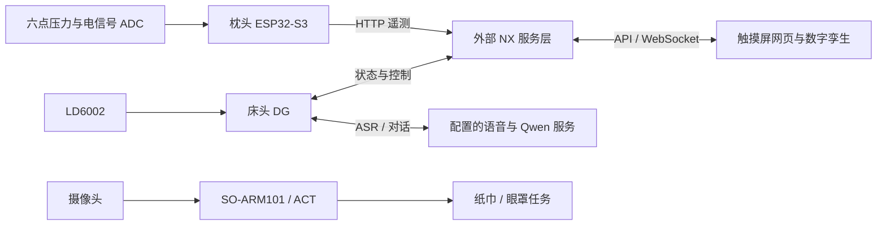

# DreamGuardian Go

**床头设备 × 智能枕头 × Jetson NX × SO-ARM101**

**Bedside device × Smart pillow × Jetson NX × SO-ARM101**

[中文](#中文) · [English](#english)

## 中文

### 项目简介

DreamGuardian Go 是一个睡眠监测、交互与辅助干预工程原型。床头 DG 采集毫米波雷达数据并管理助眠、灯光和语音；智能枕头采集六点压力与体表电信号；Jetson NX 承担数据汇聚、网页展示和外部 AI 服务对接；SO-ARM101 通过视觉 ACT 策略执行纸巾、眼罩等任务。

各模块分别配置和启动。本仓库包含两套 ESP 固件、枕头串口监测网页、NX 静态前端与离线演示、机械臂控制及策略部署代码。




### 仓库结构

| 目录 | 内容 |
|---|---|
| `main/`、`components/` | 床头 DG 固件：雷达、睡眠估计、助眠干预、显示、语音与设备接口 |
| `spiffs/`、`managed_components/` | 床头 WAV、唤醒模板及当前依赖快照 |
| `Pillow_fw/pressure_fw/` | 枕头 ESP 固件：压力、ADS1120、遥测、震动与 BLE |
| `Pillow_monitor/pressure_monitor/` | Python 串口检测服务、压力图和电信号页面 |
| `Pillow_fw/pressure_monitor/` | 附带的串口监测工具副本 |
| `DreamGuardian_web/DreamGuardian_DeviceFixed/DreamGuardian/` | NX 前端、Three.js/GLB、Windows 离线演示、API 约定 |
| `so_arm101_cseegit_code/` | 机械臂遥操作、校准、诊断与推理脚本 |
| `so_arm101_cseegit_code/so101_jetson_deploy/` | Jetson ACT 部署入口、本地 LeRobot、校准缓存 |

### 硬件与开发环境

| 模块 | 要求 |
|---|---|
| 床头 DG | ESP32-S3-BOX-3、16 MB Flash/PSRAM、LD6002；音频和灯光按接线文档连接 |
| 枕头 | ESP32-S3、六路 FSR 压力、ADS1120 SPI；可选震动和 BLE 贴片 |
| ESP 工具链 | ESP-IDF **v5.5.4**，两个独立工程不可互刷 |
| 本地网页 | Python 3；真实串口需要 `pyserial` |
| 三维开发 | Node.js/npm，仅修改 Three.js 并重新打包时需要 |
| 机械臂 | SO-ARM101、匹配舵机的独立电源、USB 串口、摄像头及兼容 Jetson/PC 环境 |

```bash
git clone https://github.com/2747179309/DreamGuardian-Go.git
cd DreamGuardian-Go
```

仓库包含多媒体和依赖快照，首次下载较大。所有串口、IP、摄像头编号均需按现场核对。

### 1. 床头 DG 编译与运行

激活 ESP-IDF v5.5.4，在仓库根目录执行：

```bash
idf.py -B build reconfigure
idf.py -B build build
idf.py -B build -p YOUR_DG_PORT flash monitor
```

将 `YOUR_DG_PORT` 替换为实际设备端口。首次应完整烧录，以写入应用、音频和语音模型分区；`Ctrl+]` 退出监视。保留根目录 `sdkconfig`，工程名仍为 `dreamguardian2`。

连接默认热点 `DreamGuardian-Control`（默认密码 `dream1234`），访问 `http://192.168.4.1/provision` 配网，通过设备 `/claw` 页面配置自己的语音网关、模型和认证。Qwen 与在线 ASR 需要另行部署。

当前离床判断要求约 30 秒新鲜无人证据，再经过约 1 秒下游确认；此前确认在床时，通信中断不立即判离床。床头自动按摩器 BLE 已退出运行配置，枕头 BLE 是独立功能。

详见[复刻指南](REPRODUCE_CN.md)、[硬件接线](HARDWARE_WIRING.md)、[睡眠流程](SLEEP_FLOW.md)。

### 2. 枕头固件

编辑 `Pillow_fw/pressure_fw/main/app_config.h`，填写自己的 Wi-Fi、NX 主机/端口、设备 ID 和上传开关。个人凭据不要提交。

在 ESP-IDF 环境执行：

```bash
cd Pillow_fw/pressure_fw
idf.py -B build set-target esp32s3
idf.py -B build build
idf.py -B build -p YOUR_PILLOW_PORT flash monitor
```

`set-target` 用于首次配置，可能重置 sdkconfig；后续直接 `build`。引脚和控制协议见[枕头说明](Pillow_fw/pressure_fw/README.md)，并与实物接线核对。

当前源码使用 ADS1120，约 100 Hz 采样并计算五频段相对功率。压力为 ADC 原始码，不是百分比或标定压力。六点上传顺序为 **P5、P6、P4、P3、P2、P1**，对应上排左中右、下排左中右。电信号波形、频谱及 `eeg` 字段名本身不能证明有效脑电或临床睡眠分期。

### 3. 枕头串口网页

从仓库根目录运行：

```bash
python -m pip install pyserial
python Pillow_monitor/pressure_monitor/server.py --port YOUR_PILLOW_PORT --baud 115200 --http 8011
```

打开 `http://127.0.0.1:8011`。串口只能由一个程序占用，烧录前停止监视。网页控制入口在连接硬件时会发送真实命令。

无硬件演示：

```bash
python Pillow_monitor/pressure_monitor/server.py --sim --http 8011
```

`--sim` 是模拟数据，不用于验证传感器。

### 4. NX 网页与离线演示

进入 `DreamGuardian_web/DreamGuardian_DeviceFixed/DreamGuardian/`，Windows 安装 Python 3 后双击 **`启动Windows离线演示.bat`**。通常地址为 `http://127.0.0.1:18766/static/offline.html`，端口占用时自动另选。离线页使用模拟数据，不操作设备。

必须通过 HTTP 打开，不能用 `file://` 加载 GLB 和模块。修改三维源码后，在网页目录执行：

```bash
npm install
npm run build:3d
```

生产部署将 `static/` 放到 NX bridge 静态目录，与后端同源。页面优先连接 `/ws/live`，失败后轮询 `/api/live`。不要把离线 mock 接入生产页。

详见[网页说明](DreamGuardian_web/DreamGuardian_DeviceFixed/DreamGuardian/README.md)和[接口约定](DreamGuardian_web/DreamGuardian_DeviceFixed/DreamGuardian/docs/API_CONTRACT.md)。

### 5. SO-ARM101 与 ACT 策略

部署目录包含本地 LeRobot、串口/摄像头诊断、校准和 `tissue`、`eyemask` 推理入口。

**当前分支未找到策略权重文件或部署 `models/` 目录。** 子目录文档提到的 `act_tissue`、`act_eyemask` 需要另外提供。当前推理脚本默认模型路径仍指向原 Windows 电脑，因此必须显式传入 `--model-path`。

先准备与目标 JetPack/Python/CUDA 匹配的 PyTorch、torchvision，阅读环境脚本后运行：

```bash
cd so_arm101_cseegit_code/so101_jetson_deploy
bash setup_jetson_env.sh
python3 test_arm_port.py --port /dev/ttyACM0
python3 test_camera.py --index 0 --no-display
python3 eval_so101.py --task tissue --model-path ./models/act_tissue --port /dev/ttyACM0 --camera-index 0
python3 eval_so101.py --task eyemask --model-path ./models/act_eyemask --port /dev/ttyACM0 --camera-index 0
```

环境脚本安装依赖、设置串口权限并复制校准缓存；新机械臂必须核对自己的标定。确认供电、摄像头与工作区域后再启动运动。这是 **ACT 策略**部署，不等同于已验证的通用语言 VLA。

详见[部署说明](so_arm101_cseegit_code/so101_jetson_deploy/README.md)、[Jetson 指南](so_arm101_cseegit_code/so101_jetson_deploy/DEPLOY_GUIDE_JETSON.md)和[机械臂指南](so_arm101_cseegit_code/SO101_ARM_GUIDE.md)。

### 接口与联调

| 接口 | 用途 |
|---|---|
| `POST /api/pillow/telemetry` | 枕头压力、接触和震动反馈，约 2 Hz |
| `POST /api/esp/telemetry` | 原始电信号批次、频段和设备状态，约 2 Hz |
| `/ws/live`、`/api/live` | NX 网页实时数据与轮询回退 |
| DG `/api/status`、`/api/claw_tool` | 设备状态与白名单工具 |
| 网关 `/v1/chat/completions` | 配置的在线对话/音频回复链路 |

请求格式以源码和 API 约定为准。旧 `/api/pillow/waveform` 方案未实现。NX 后端需另行提供接收、校验、缓存和网页接口。

建议顺序：分别验证两块 ESP 原始数据 → 六点映射及电信号质量 → NX 遥测 → 生产网页 → 助眠/语音/离床回床 → 整夜检测。机械臂独立验证串口、摄像头和标定后再加载策略。

| 问题 | 检查 |
|---|---|
| GLB 加载失败 / 404 | HTTP 服务、`static/models/`、资源路径 |
| 串口页无数据 | 设备身份、端口占用、115200 波特率、固件输出 |
| NX 网页离线 | 后端、同源 API/WebSocket、遥测时间戳 |
| 热力图错位 | 固件上传顺序与页面映射 |
| 模型找不到 | 权重是否存在、`--model-path` |
| 机械臂不动 | 独立电源、串口、标定、相机和日志 |

### 状态、凭据与许可

本文根据仓库文件整理，不代表已在新机器完成端到端验收。床头固件之前完成增量编译和烧录校验；整夜稳定性、生理信号有效性及联动需硬件实测。

枕头配置及其子目录说明仍含历史 Wi-Fi 凭据，维护者应移除并轮换已公开密码；本文不重复这些凭据。不要提交个人 API 密钥或 NVS 数据。

第三方组件、LeRobot、三维素材遵循各自许可证。仓库未提供覆盖全部原创代码、音频和策略权重的统一许可证，复用前分别核对。本项目是研究与工程原型，不提供医疗诊断。

## English

### Overview

DreamGuardian Go is a sleep-monitoring, interaction and assistive-intervention prototype. The bedside device acquires radar data and manages audio, lighting and voice. The pillow collects six-zone pressure and surface electrical signals. Jetson NX provides integration and dashboard services, while SO-ARM101 runs separate vision-based ACT manipulation tasks.

The repository contains two ESP projects, a serial pillow monitor, an NX frontend/offline demo and robot control/deployment code. NX backend services, Qwen and online ASR are external deployment requirements. Robot scripts do not imply automatic voice-to-arm integration.

### Repository layout

| Path | Purpose |
|---|---|
| `main/`, `components/` | Bedside radar, sleep estimates, assistance, display, voice and APIs |
| `spiffs/`, `managed_components/` | Audio/templates and current dependency snapshot |
| `Pillow_fw/pressure_fw/` | Pillow pressure, ADS1120, telemetry, vibration and BLE firmware |
| `Pillow_monitor/pressure_monitor/` | Local Python serial monitoring pages |
| `Pillow_fw/pressure_monitor/` | Additional monitoring-tool copy |
| `DreamGuardian_web/DreamGuardian_DeviceFixed/DreamGuardian/` | NX frontend, Three.js/GLB, offline demo and API contract |
| `so_arm101_cseegit_code/` | Robot teleoperation, calibration, diagnostics and inference |
| `so_arm101_cseegit_code/so101_jetson_deploy/` | Jetson ACT deployment and local LeRobot |

### Requirements and clone

Use **ESP-IDF v5.5.4**. The bedside target is ESP32-S3-BOX-3 with 16 MB Flash/PSRAM and LD6002; the pillow is a separate ESP32-S3 project with six pressure inputs and ADS1120. Never interchange these firmware images. Follow [hardware wiring](HARDWARE_WIRING.md).

Local pages require Python 3; real serial monitoring requires `pyserial`. Node.js/npm are needed to rebuild the 3D frontend. The robot requires a compatible independent servo supply, USB serial, camera and Jetson/PC environment.

```bash
git clone https://github.com/2747179309/DreamGuardian-Go.git
cd DreamGuardian-Go
```

The initial download includes dependencies and multimedia. Verify all ports, host addresses and camera indices on your own equipment.

### 1. Bedside firmware

Activate ESP-IDF v5.5.4 and run at the repository root:

```bash
idf.py -B build reconfigure
idf.py -B build build
idf.py -B build -p YOUR_DG_PORT flash monitor
```

Perform a full flash on a fresh device to install the application, audio filesystem and speech-model partition. Exit with `Ctrl+]`. Keep the supplied `sdkconfig`; the project remains named `dreamguardian2`.

Connect to the default `DreamGuardian-Control` AP using `dream1234`, open `http://192.168.4.1/provision`, and configure your gateway/model/credentials through `/claw`. ASR and Qwen services must be provided separately.

Bed exit now requires approximately 30 seconds of fresh absence evidence plus approximately one second of downstream confirmation. Communication loss does not immediately clear previously confirmed occupancy. Automatic bedside massage BLE is retired; pillow BLE belongs to its own firmware.

See [reproduction guide](REPRODUCE_CN.md), [wiring](HARDWARE_WIRING.md) and [sleep flow](SLEEP_FLOW.md).

### 2. Pillow firmware

Set your Wi-Fi, NX host/port, device ID and upload options in `Pillow_fw/pressure_fw/main/app_config.h`. Keep personal credentials out of commits.

```bash
cd Pillow_fw/pressure_fw
idf.py -B build set-target esp32s3
idf.py -B build build
idf.py -B build -p YOUR_PILLOW_PORT flash monitor
```

`set-target` is for initial configuration and may reset sdkconfig; subsequent builds only need `build`. Check the [pillow guide](Pillow_fw/pressure_fw/README.md) against your wiring.

ADS1120 acquisition runs at approximately 100 Hz and calculates five relative frequency-band powers. Pressure values are ADC counts, not percentages or calibrated pressure. Uploaded order is **P5, P6, P4, P3, P2, P1**, from upper-left to lower-right. A waveform, spectrum or `eeg` field does not establish valid EEG or clinical sleep staging.

### 3. Local serial monitor

From the repository root:

```bash
python -m pip install pyserial
python Pillow_monitor/pressure_monitor/server.py --port YOUR_PILLOW_PORT --baud 115200 --http 8011
```

Open `http://127.0.0.1:8011`. Stop the monitor before flashing because serial access is exclusive. Hardware control pages send actual commands when connected.

Hardware-free demo:

```bash
python Pillow_monitor/pressure_monitor/server.py --sim --http 8011
```

Simulation does not validate sensor operation.

### 4. NX frontend and offline demonstration

Frontend root: `DreamGuardian_web/DreamGuardian_DeviceFixed/DreamGuardian/`.

On Windows with Python 3 installed, run **`启动Windows离线演示.bat`** there. The usual URL is `http://127.0.0.1:18766/static/offline.html`; the launcher selects another port if occupied. Offline data is simulated and does not operate devices.

Serve over HTTP instead of opening HTML through `file://`. To rebuild the 3D scene, run in the frontend root:

```bash
npm install
npm run build:3d
```

Deploy `static/` to the NX bridge with the same origin as the backend. Live updates use `/ws/live`, falling back to `/api/live`. Do not include offline mocks in production.

See the [frontend guide](DreamGuardian_web/DreamGuardian_DeviceFixed/DreamGuardian/README.md) and [API contract](DreamGuardian_web/DreamGuardian_DeviceFixed/DreamGuardian/docs/API_CONTRACT.md).

### 5. SO-ARM101 / ACT

The deployment package includes local LeRobot, diagnostics, calibration and tissue/eye-mask inference options.

**No policy weight files or deployment `models/` directory were found in the current branch.** Obtain the `act_tissue` and `act_eyemask` checkpoints separately. The script still defaults to an original Windows model path; explicitly pass `--model-path`.

Prepare PyTorch/torchvision compatible with your JetPack/Python/CUDA versions, review the setup script, then run:

```bash
cd so_arm101_cseegit_code/so101_jetson_deploy
bash setup_jetson_env.sh
python3 test_arm_port.py --port /dev/ttyACM0
python3 test_camera.py --index 0 --no-display
python3 eval_so101.py --task tissue --model-path ./models/act_tissue --port /dev/ttyACM0 --camera-index 0
python3 eval_so101.py --task eyemask --model-path ./models/act_eyemask --port /dev/ttyACM0 --camera-index 0
```

The setup script installs dependencies, changes serial permissions and copies calibration. Confirm calibration for your own arm, independent power, camera placement and clear workspace before motion. These are **ACT policies**, not a claim of validated general language-driven VLA.

See the [deployment README](so_arm101_cseegit_code/so101_jetson_deploy/README.md), [Jetson guide](so_arm101_cseegit_code/so101_jetson_deploy/DEPLOY_GUIDE_JETSON.md) and [arm guide](so_arm101_cseegit_code/SO101_ARM_GUIDE.md).

### Interfaces and validation

| Interface | Purpose |
|---|---|
| `POST /api/pillow/telemetry` | Pressure, contact and vibration telemetry, approximately 2 Hz |
| `POST /api/esp/telemetry` | Electrical-signal batches, bands and metrics, approximately 2 Hz |
| `/ws/live`, `/api/live` | Dashboard live updates and polling fallback |
| DG `/api/status`, `/api/claw_tool` | Device status and whitelisted tools |
| Gateway `/v1/chat/completions` | Configured online conversation/audio workflow |

Refer to code and contracts for payloads. The old `/api/pillow/waveform` proposal is not implemented. NX ingestion, validation, caching and dashboard backend APIs must be deployed separately.

Validate raw ESP data, zone mapping/signal quality, NX ingestion, production UI, voice/assistance and bed-exit/return before overnight testing. Validate robot serial/camera/calibration independently before policy inference.

| Symptom | Check |
|---|---|
| GLB failure / 404 | HTTP serving, `static/models/`, asset URLs |
| No serial data | Correct device, exclusive port access, baud rate, firmware output |
| NX page offline | Backend, same-origin routes, API/WebSocket, telemetry freshness |
| Misaligned pressure | Firmware order and frontend mapping |
| Policy not found | Checkpoint files and `--model-path` |
| No arm motion | Independent power, serial, calibration, camera and logs |

### Status, credentials and licensing

This README describes checked-in files, not fresh end-to-end validation on a new machine. Bedside firmware previously passed incremental compilation and flash verification. Overnight stability, physiological signal validity and full integration require hardware testing.

Historical Wi-Fi credentials remain in the pillow configuration and its module documentation. Maintainers should remove them and rotate the published password. They are not repeated here. Do not commit personal API keys or NVS dumps.

Third-party components, LeRobot and 3D assets retain their own licenses. No repository-wide license currently covers all original code, audio and policy weights; check permissions per asset. This is a research and engineering prototype, not a medical diagnostic system.
